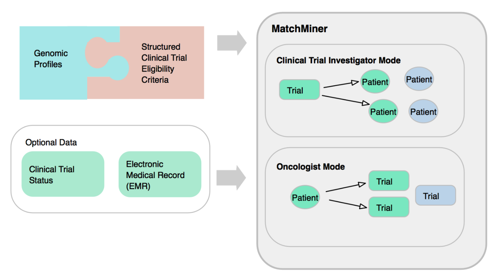

# MatchMiner


MatchMiner is open-source software for clinical trial matching, built and used at Dana-Farber Cancer Institute since 2016. It is a suite of three tools: MatchMiner Genomics, MatchMiner-AI, and MatchMiner Dashboard.

**Website: [matchminer.org](https://matchminer.org)**

## MatchMiner Genomics

Matches patients whose tumors have been sequenced to precision medicine trials. Each trial's eligibility is written in Clinical Trial Markup Language (CTML), and the MatchEngine checks every patient's genomic and clinical data against it. It finds trials for a specific patient, or patients for a specific trial.



- Code: [matchengine-V2](https://github.com/dfci/matchengine-V2) (matching engine), [matchminer-api](https://github.com/dfci/matchminer-api) (stores patient data and match results), [matchminer-ui](https://github.com/dfci/matchminer-ui) (web interface)
- [Documentation](https://matchminer.gitbook.io/matchminer/)

## MatchMiner-AI

Uses language models to read a patient's clinical notes and suggest trials for the oncologist to review, including trials with no genomic criteria. The models are trained entirely on synthetic medical records, so the weights and training data are public.

- Code: [matchminer-ai-inference](https://github.com/dfci/matchminer-ai-inference) (`pip install matchminer-ai`) and [matchminer-ai-training](https://github.com/dfci/matchminer-ai-training)
- Models and synthetic data: [Hugging Face](https://huggingface.co/ksg-dfci)
- [Documentation](https://dfci.github.io/matchminer-ai-inference)

## MatchMiner Dashboard

One view for trial management: open slots, enrollment, and milestones. It is in production at Dana-Farber; its code is due for release in winter 2026–27.

## Getting started

To try a MatchMiner Genomics demo on macOS or Linux, run:

```
 /bin/bash -c "$(curl -fsSL https://matchminer.org/setup.sh)"
```

This requires bash, cURL, git, docker, and docker-compose. The demo runs at http://localhost:1952.

For MatchMiner-AI, see its [documentation](https://dfci.github.io/matchminer-ai-inference). The website's [Get started](https://matchminer.org/get-started.html) page covers what each tool needs.

## Citing MatchMiner

- MatchMiner Genomics: Klein H. et al., [MatchMiner: an open-source platform for cancer precision medicine](https://doi.org/10.1038/s41698-022-00312-5), *npj Precision Oncology* 2022;6:69.
- MatchMiner-AI: Altreuter J. et al., [MatchMiner-AI: An Open-Source Solution for Cancer Clinical Trial Matching](https://arxiv.org/abs/2412.17228), arXiv:2412.17228 (2024).

## Contact

Questions about deploying MatchMiner or collaborating: see [matchminer.org/contact](https://matchminer.org/contact.html). Bug reports go in the relevant repository's issues.

The source for the website is on the [`site`](https://github.com/dfci/matchminer/tree/site) branch of this repository.
